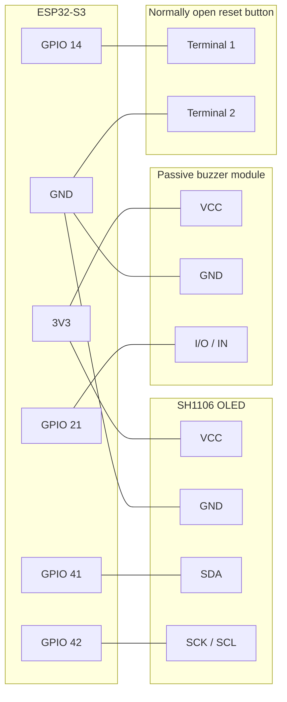

# SAFE ROAD firmware

[Full setup, wiring, troubleshooting, and source code guide](docs/GUIDE.md)

[Gmail SMTP and MacroDroid webhook setup](docs/NOTIFICATIONS.md)

ESP32-S3 N16R8 firmware for the OV5640 camera, SH1106 OLED and passive buzzer.
Face monitoring and buzzer alerts run on the ESP32. The dashboard provides
camera preview, calibration, Wi-Fi setup, email and webhook settings.

### First-time setup on Windows

Start with a fresh checkout or source archive of this branch. If transferring
the source to another laptop, use a Git archive so machine-specific files
such as `build`, `managed_components`, `dependencies.lock`, and `sdkconfig`
are generated on the new laptop.

Install ESP-IDF 5.5.6. Connect the board with a USB data cable, then open
PowerShell as Administrator in the repository root and run:

```powershell
powershell.exe -NoProfile -ExecutionPolicy Bypass -File .\tools\install-usb-driver.ps1
```

The script prints the COM port if Windows already recognizes the board. If
the port is missing, it downloads the matching driver package from Espressif
and installs it. It supports native ESP32-S3 USB Serial/JTAG, CP210x, and
CH340/CH341. Internet access is required for the download.

Open an ESP-IDF 5.5.6 terminal in the repository root. Verify the SDK before
building and use the COM port printed by the driver script:

```powershell
idf.py --version
idf.py -p COM11 flash monitor
```

Use your board's serial port. To view serial logs only, use
`idf.py -p COM11 monitor`. Press Ctrl+] to exit the monitor.

Connect to the device hotspot and open http://192.168.4.1. The default hotspot
is SAFE_ROAD_xxxxxx with password 12345678. Calibrate from the dashboard if
needed. Saved calibration and settings use the same flash partitions as the
previous smaller firmware. Use Wi-Fi & notifications to configure the hotspot,
email and webhooks, and the events and hold times that trigger alerts.



This prototype provides experimental camera-based alerts. Firmware source and
runtime model files live in main/, bundled ESP-IDF components in
components/, and host checks in tests/. Model conversion experiments
are available on the main branch.

Use a normally open momentary button between GPIO 14 and GND. After boot,
hold it for five seconds to restore SAFE_ROAD_xxxxxx / 12345678 and restart.
This resets only the hotspot credentials.
