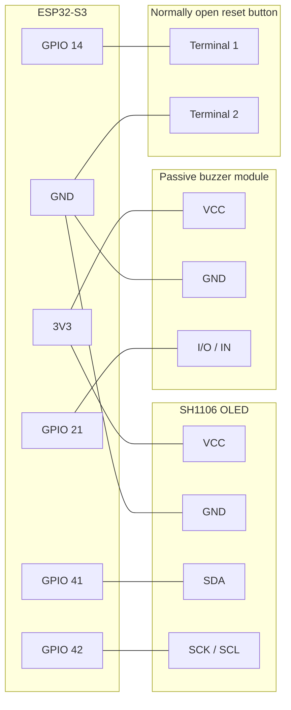

# SAFE ROAD setup and code guide

This guide covers the root ESP-IDF project on the firmware branch. The ESP32-S3
N16R8 runs face monitoring locally using an OV5640 camera. The SH1106 OLED,
passive buzzer and reset button are optional external peripherals.

## Wiring

Disconnect power before moving wires. Match labels on the actual module.



On a four-leg button, choose two terminals that are connected only when pressed.
The firmware enables an internal pull-up. Pressing the button pulls GPIO 14 low.

The camera uses XCLK 15, PCLK 13, VSYNC 6, HREF 7, SCCB SDA 4 and SCL 5.
Its data lines D0–D7 use 11, 9, 8, 10, 12, 18, 17 and 16 respectively.
Camera SCCB uses I²C controller 1, OLED uses controller 0. The camera uses
LEDC timer/channel 0 and the buzzer uses timer/channel 1. See
[start_camera](../main/main.cpp#L232) and [OLED/buzzer code](../main/hardware.cpp).

## Build, flash and monitor

Open an ESP-IDF 5.5 terminal in the repository root. The project selects ESP32-S3
and supplies 16 MB flash and 8 MB octal PSRAM defaults. The bundled components
and model files are in the branch.

```powershell
idf.py build
idf.py -p COM11 flash monitor
```

Replace COM11 with the port shown for your board. To inspect logs without
flashing, run `idf.py -p COM11 monitor`. Press Ctrl+] to exit.

## Dashboard and calibration

1. Join the device hotspot. The default is `SAFE_ROAD_xxxxxx`, where the suffix
   comes from the device MAC address. The default password is `12345678`.
2. Open http://192.168.4.1 and check the camera preview.
3. While seated and stationary, start calibration and follow the dashboard poses.
   Tap Ready when prompted. Capture begins after a four-second countdown and
   each stage collects 12 usable samples. The completed set saves on the ESP32.
4. Return to neutral and check that the live face, eyes, mouth, head-down, tilt
   and looking-away readings change. Use the individual pose buttons to redo
   a calibration stage as needed.

The prototype estimates eye, mouth and head states from camera geometry. Use
bench tests to assess its behavior before relying on the readings.

## Wi-Fi, alerts and physical reset

Under **Wi-Fi & notifications**, connect the ESP32 to your upstream Wi-Fi.
The dashboard reports whether hotspot IPv4 internet sharing is ready. If the
phone already joined the hotspot, reconnect to refresh its DNS settings.

Use **Device hotspot** to set its name and password. Applying settings restarts
the board. To recover the defaults without the dashboard, boot with the button
released, then hold GPIO 14's button for five seconds. The firmware erases only
the saved hotspot configuration and restarts. Rejoin the default hotspot and
open http://192.168.4.1.

Load notification settings and choose event types and hold times. The default
hold times are 1.5 seconds for eyes closed, 3 seconds for mouth open, and 2.5
seconds each for head down, looking away and head tilt. You can set each to
0.5–60 seconds. The buzzer sounds in bursts alongside the full-screen OLED
alert at each configured count milestone, including offline. Remote alerts use a per-event cooldown and run in a worker
separate from camera processing. The OLED displays one active alert at a time.

For step-by-step setup, see [Gmail SMTP and MacroDroid webhooks](NOTIFICATIONS.md).

The OLED shows a SAFE ROAD standby screen when the camera sees no face. When a
face is visible, it shows live readings and Wi-Fi status. Each detection type
briefly gets a full-screen alert when its count reaches a multiple of the
configured notification count. The alert appears even when email and webhook
delivery are disabled.

## Where the code lives

| Feature | File | Start here |
| --- | --- | --- |
| Project and dependencies | [CMakeLists.txt](../CMakeLists.txt), [main/CMakeLists.txt](../main/CMakeLists.txt), [components/](../components/) | ESP32-S3 target, source registration and bundled libraries |
| Flash layout and board defaults | [partitions.csv](../partitions.csv), [sdkconfig.defaults](../sdkconfig.defaults) | NVS, factory app, flash, PSRAM and networking |
| Camera, calibration and monitoring | [main.cpp](../main/main.cpp) | `app_main`, `start_camera`, `face_task`, `track_frame`, `publish_progress` |
| Detector and landmarks | [v7_engine.hpp](../main/v7_engine.hpp), [v7_math.hpp](../main/v7_math.hpp), [small_features.hpp](../main/small_features.hpp) | `Engine::init`, `Engine::run`, camera crop and geometry calculations |
| Embedded models | [detector.espdl](../main/detector.espdl), [landmark.espdl](../main/landmark.espdl) | Model files embedded by the component build |
| Dashboard and API | [index.html](../main/index.html), [main.cpp](../main/main.cpp) | UI polling and forms, `status_handler`, `start_http` |
| Hotspot and reset | [main.cpp](../main/main.cpp), [ap_settings.hpp](../main/ap_settings.hpp), [network_policy.hpp](../main/network_policy.hpp) | `start_network`, `hotspot_handler`, `hotspot_reset_button_task`, subnet overlap checks |
| OLED, buzzer and internet probe | [hardware.cpp](../main/hardware.cpp), [hardware_policy.hpp](../main/hardware_policy.hpp), [Kconfig.projbuild](../main/Kconfig.projbuild) | `init_oled`, `draw`, `set_buzzer`, `internet_task` |
| Alert rules and delivery | [alert_policy.hpp](../main/alert_policy.hpp), [alerts.cpp](../main/alerts.cpp), [smtp_protocol.hpp](../main/smtp_protocol.hpp) | `Gate::take`, `observe`, background worker, SMTP and HTTPS |
| Host checks | [tests/](../tests/) | Dashboard, geometry, alert, buzzer, hotspot and subnet checks |

### Follow one detection through the firmware

1. `face_task` reads a camera frame, calls `Engine::run`, and updates
   telemetry from the result.
2. `track_frame` compares the measurements with calibration and updates
   the time spent in each detected state. It passes the five durations to
   the notification policy.
3. `alerts::observe` applies enabled events, hold times and cooldowns, then
   queues eligible deliveries. The worker sends SMTP or HTTPS.
4. The OLED and buzzer task reads the same telemetry snapshot. The dashboard
   polls `/api/status` for the snapshot and `/api/frame` for the camera preview.

This excerpt from the monitoring path shows the duration order used by the
shared alert policy:

```cpp
const int64_t durations[5]={eye_ms,mouth_ms,down_ms,away_ms,tilt_ms};
alerts::observe(durations);
```

The hardware button is configured in [main.cpp](../main/main.cpp#L957).
The loop checks how long the pin stays low. On success it erases
`safe_road/ap_settings` and calls `esp_restart()`. On boot, the fallback
credentials are used when that key is absent.

```cpp
static constexpr gpio_num_t HOTSPOT_RESET_PIN=GPIO_NUM_14;
```

## Troubleshooting

| Symptom | Check |
| --- | --- |
| OLED has no picture | Verify 3.3 V at the module and check SDA 41, SCL 42 and common ground. Look for an ACK at 0x3C or 0x3D in the serial log. |
| OLED shows only part of a frame | Look for OLED refresh errors. Check jumper contact if retries keep failing. |
| OLED and dashboard both show no face | Check camera framing, lighting and the serial `FACE WAIT` message. |
| Buzzer stays silent | Check calibration, GPIO 21, event selection and hold time. Verify the OLED reports the sustained alert. |
| Reset button has no effect | Confirm it shorts GPIO 14 to GND when pressed. Release after boot, then hold for five seconds and look for the reset log. |
| Internet stays unverified | Check upstream Wi-Fi, clock sync and the serial probe error. |
| MacroDroid test returns 404 | Check that the URL includes the saved trigger identifier and that the macro is enabled. |
| Gmail test fails | Check the sender, recipient, app password, internet connection and exact delivery status. |

Run the dashboard host checks from the root with Node.js:

```powershell
node tests/dashboard_test.cjs
node tests/notifications_ui_test.cjs
```
